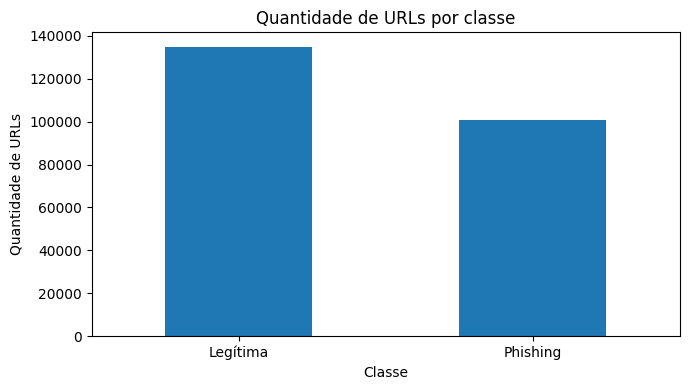
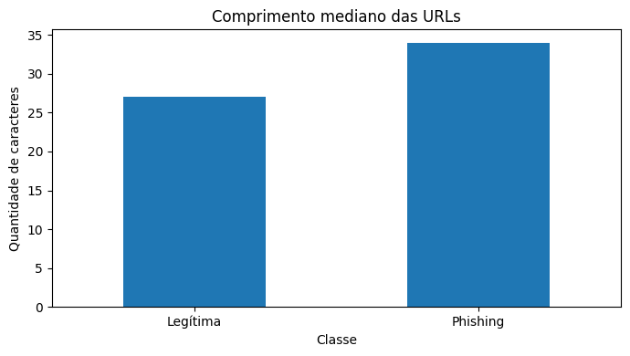
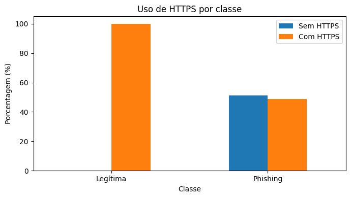
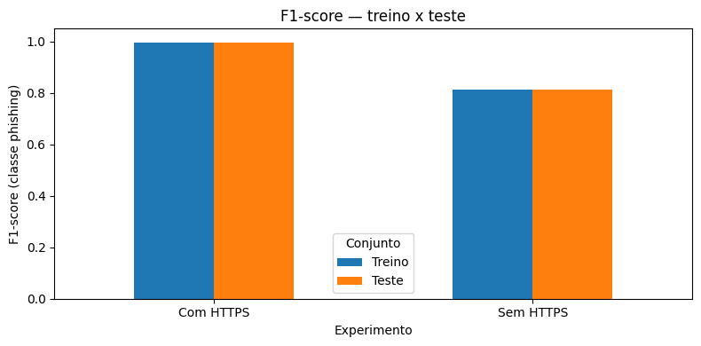
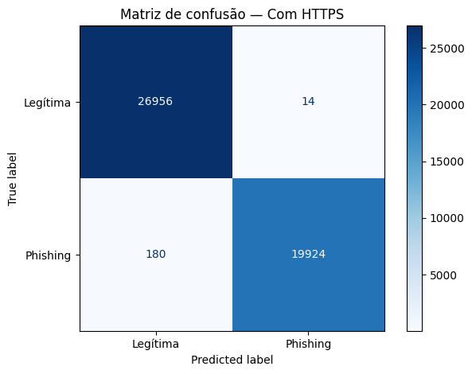
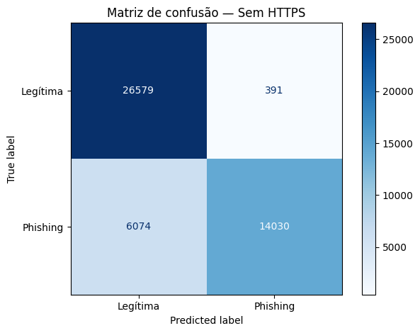
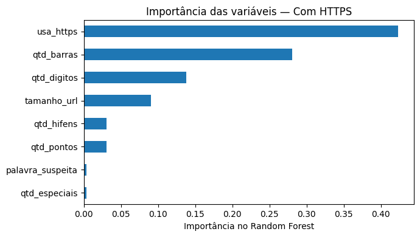
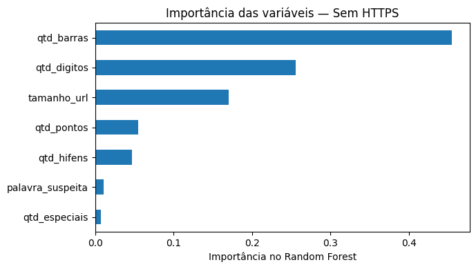

# Anexo de gráficos — Escudo Cidadão

**Global Solution FIAP 2026.2 · Inteligência Artificial e Machine Learning**  
**Grupo:** MindSync

Este anexo complementa o [relatório principal](RELATORIO_ML.md), mantendo o texto-base dentro do escopo de 2 a 4 páginas do edital. As figuras já foram geradas no projeto e são provenientes da análise exploratória e dos modelos treinados, não de dados inventados.

## 1. Análise exploratória

### Figura A — Distribuição das classes

Após remoção de 425 URLs repetidas, o estudo considerou **235.370 URLs**, sendo **134.850 legítimas** e **100.520 de phishing**. A distribuição orientou o uso de divisão estratificada e avaliação além da acurácia.

### Figura B — Comprimento das URLs

A figura apresenta a distribuição do comprimento das URLs. Comprimento é uma característica lexical do texto e não basta, isoladamente, para determinar risco.

### Figura C — HTTPS por classe

A frequência de HTTPS difere fortemente entre as classes do dataset. Uma parcela expressiva dos links rotulados como phishing também usa HTTPS; portanto, **HTTPS não é uma garantia de legitimidade**.

## 2. Desempenho dos experimentos

Os modelos Random Forest foram ajustados com **12 combinações de três hiperparâmetros por experimento**, usando validação cruzada estratificada de três partições sobre uma subamostra exclusivamente do treino. Os modelos finais foram ajustados no conjunto completo de treinamento.

### Figura D — Comparação de F1 em treino e teste

| Modelo | F1 treino | F1 teste |
|---|---:|---:|
| Com HTTPS | 99,51% | 99,52% |
| Sem HTTPS | 81,43% | 81,27% |

A proximidade entre treino e teste sugere ausência de diferença expressiva nessa partição aleatória, mas **não prova generalização para domínios ou períodos diferentes**.

### Figura E — Matriz de confusão: com HTTPS

No teste, foram registrados **14 falsos positivos** e **180 falsos negativos**. Falso negativo, aqui, corresponde a uma URL de phishing classificada como legítima.

### Figura F — Matriz de confusão: sem HTTPS

No teste, foram registrados **391 falsos positivos** e **6.074 falsos negativos**, evidenciando forte perda de sensibilidade à classe phishing na amostra estudada.

## 3. Interpretabilidade dos modelos

### Figura G — Importância de variáveis: com HTTPS

O gráfico registra a importância estimada pelo Random Forest para os oito atributos lexicais, incluindo HTTPS. **Importância estatística do modelo não implica causalidade**, nem significa que HTTPS seja uma regra universal para validar sites.

### Figura H — Importância de variáveis: sem HTTPS

O segundo gráfico permite observar a redistribuição de importância entre os sete atributos restantes após excluir HTTPS, mantendo a mesma base e o mesmo conjunto reservado para teste.

## 4. Fonte, reprodutibilidade e limites

- **Dados reais:** [PhiUSIIL Phishing URL Dataset — UCI](https://archive.ics.uci.edu/dataset/967/phiusiil+phishing+url+dataset), publicação de 2024. O período exato da coleta não está estabelecido no arquivo utilizado.
- **Código e execução:** [notebook](notebook_escudo_cidadao.ipynb), [dependências](requirements.txt), [origem e download da base](dados/README.md).
- **Métricas exportadas:** [treino/teste](modelos/resultados_treino_teste.csv) e [validação cruzada](modelos/resultados_validacao.csv).
- **Escopo:** o dataset não possui recorte municipal comprovado e não substitui a exigência de uma CitizenTech unificada entre disciplinas.
- **Uso responsável:** classificação preditiva não comprova a segurança de uma URL; o projeto não visita os links analisados.

*Fonte das figuras: elaboração própria a partir do PhiUSIIL Phishing URL Dataset e das saídas do notebook do projeto.*
