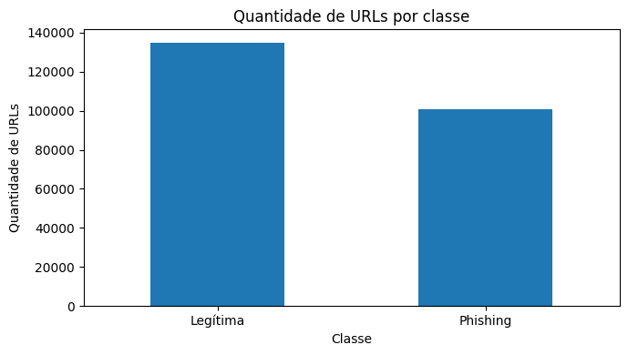
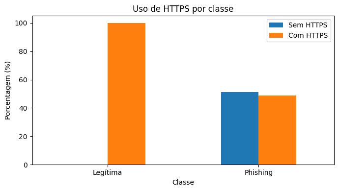
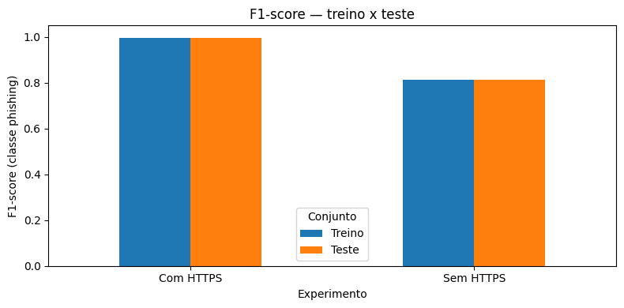
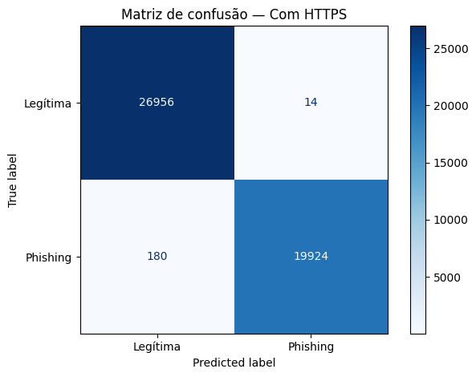
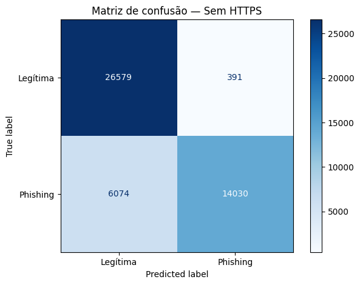

# FIAP — Faculdade de Informática e Administração Paulista

# GLOBAL SOLUTION — 2026.2
## ESCUDO CIDADÃO
### Classificação de URLs de phishing: análise comparativa com e sem HTTPS

**Inteligência Artificial e Machine Learning · CitizenTech**

**Integrantes**

| Nome | RM |
|---|---:|
| Rickelmyn de Souza Ruescas | 556055 |
| Juan Fuentes Rufino | 557673 |
| Heloísa Fleury Jardim | 556378 |
| Pedro Henrique Silva Batista | 558137 |
| Paulo Henrique Monteiro Golovanevsky | 555300 |

**São Paulo — 2026**

---

## Resumo

O projeto estuda padrões de URLs associados a phishing em dados públicos, comparando duas configurações de Random Forest: uma com a variável HTTPS e outra sem ela. Foram utilizados 235.370 registros após limpeza, oito atributos lexicais simples e uma avaliação com busca de 12 combinações de hiperparâmetros, validação cruzada apenas no treino e comparação entre treino e teste. O estudo discute tanto os resultados quanto suas limitações para aplicação real.

**Palavras-chave:** phishing; aprendizagem supervisionada; Random Forest; segurança digital; HTTPS.

## 1. Introdução e objetivo

O phishing é uma modalidade de fraude digital que utiliza mensagens e endereços enganosos para induzir pessoas a fornecer informações sensíveis. O Escudo Cidadão investiga se atributos extraídos exclusivamente do texto de uma URL podem apoiar sua classificação. A pergunta central é: **qual é o impacto da variável HTTPS no desempenho de um classificador Random Forest?**

## 2. Base de dados e análise exploratória

Utilizamos o *PhiUSIIL Phishing URL Dataset* (UCI, 2024), com **235.795 observações e 56 colunas** na versão original. Foram preservadas somente as colunas URL e label. Após excluir **425 URLs repetidas**, restaram **235.370 registros**: **134.850 legítimos** e **100.520 de phishing**. O rótulo original foi convertido para phishing = 1. Não foram realizadas requisições aos endereços analisados. **A fonte publica o conjunto em 2024; o período exato de coleta das URLs não pôde ser estabelecido a partir do CSV.** Os registros são reais, mas não permitem inferir a distribuição do phishing especificamente em São Paulo ou em outro município.

*Figura 1. Distribuição das URLs após limpeza. Fonte: elaboração própria a partir do PhiUSIIL/UCI.*

*Figura 2. Frequência relativa de HTTPS em cada classe. Fonte: elaboração própria a partir do PhiUSIIL/UCI.*

## 3. Engenharia de atributos

Foram criados oito atributos de fácil interpretação: comprimento da URL; quantidade de dígitos, pontos, hífens, barras e caracteres especiais; presença de palavras associadas a acesso a contas; e **uso de HTTPS**. O segundo modelo utiliza exatamente os mesmos atributos, exceto HTTPS. Na amostra, todas as URLs legítimas usam HTTPS, mas cerca de **48,6% das URLs de phishing também usam**. Essa associação exige cautela: HTTPS não comprova que um site seja confiável.

## 4. Modelo e metodologia

Amostra dividida de forma estratificada em **80% treino (188.296)** e **20% teste (47.074)**, usando semente 42. Em cada experimento, avaliamos **12 combinações de 3 hiperparâmetros**: número de árvores (30, 50, 80), profundidade máxima (8, 14) e mínimo de amostras por folha (1, 4). A seleção utilizou **validação cruzada estratificada de 3 partes** e F1-score, sobre uma subamostra de 25 mil exemplos retirada apenas do treino. A escolha do Random Forest se deve à capacidade de modelar relações não lineares entre atributos numéricos, com treinamento reproduzível e possibilidade de inspecionar a importância das variáveis. Os melhores parâmetros (80, 14, 4) foram, então, reajustados em todo o treino e avaliados no teste reservado.

| Configuração | Descrição |
|---|---|
| Modelo A | Random Forest com oito atributos (inclui HTTPS) |
| Modelo B | Random Forest com sete atributos (exclui HTTPS) |
| Busca | 12 combinações por modelo (3 hiperparâmetros) |
| Validação | StratifiedKFold, 3 partes, somente treino |
| Critério | F1-score da classe phishing |
| Avaliação final | Mesmo conjunto de teste para ambos os modelos |

## 5. Resultados e interpretação

| Modelo | Partição | Acurácia | Precisão | Recall | F1-score |
|---|---|---:|---:|---:|---:|
| Com HTTPS | Treino | 99,58% | 99,95% | 99,08% | 99,51% |
| Com HTTPS | Teste | 99,59% | 99,93% | 99,10% | 99,52% |
| Sem HTTPS | Treino | 86,38% | 97,50% | 69,91% | 81,43% |
| Sem HTTPS | Teste | 86,27% | 97,29% | 69,79% | 81,27% |

Na validação cruzada, o melhor F1 foi de **99,35% com HTTPS** e **80,87% sem HTTPS**. Os modelos selecionaram 80 árvores, profundidade máxima 14 e mínimo de quatro amostras por folha.

*Figura 3. F1-score de treino e teste nos dois experimentos. Fonte: elaboração própria.*

Com HTTPS, o F1-score de teste foi de **99,52%**; sem HTTPS, de **81,27%**. O recall caiu de **99,10%** para **69,79%**, mostrando que a retirada dessa variável reduz substancialmente a identificação de URLs de phishing nesta base. As diferenças entre treino e teste foram pequenas em ambos os experimentos, não indicando overfitting expressivo **nesta divisão aleatória**. Esse resultado não elimina possível dependência entre URLs de domínios semelhantes nem demonstra desempenho em URLs novas ou em outra distribuição.

*Figura 4. Matriz de confusão do modelo com HTTPS: 14 falsos positivos e 180 falsos negativos.*

*Figura 5. Matriz de confusão do modelo sem HTTPS: 391 falsos positivos e 6.074 falsos negativos.*

**Gráficos complementares:** veja o [anexo com as oito figuras](ANEXO_GRAFICOS.md), incluindo distribuição de comprimentos e importância dos atributos dos dois classificadores.

## 6. Discussão, limitações e aplicação prática

O experimento revela uma dependência forte da informação HTTPS no dataset, **não uma regra universal de segurança**. A aplicação Streamlit demonstra as duas classificações sem abrir os links analisados, com caráter educativo. O estudo não avalia URLs recentes fora da base, nem generalização por domínio; além disso, **não atende ao requisito de dados vinculados a uma cidade**, exclusão definida para esta versão. Para o cidadão, o resultado ilustra que **HTTPS sozinho não atesta legitimidade** e que classificadores devem ser tratados como apoio educativo, não como vereditos definitivos. Como continuidade, recomenda-se validação externa e temporal antes de qualquer uso real de proteção. **Conformidade com a proposta:** permanecem pendentes o recorte territorial com dados reais de uma cidade e a articulação comprovável desta frente de ML com a mesma CitizenTech das demais disciplinas; esses requisitos não são resolvidos somente pela documentação.

## 7. Referências

- UCI MACHINE LEARNING REPOSITORY. **PhiUSIIL Phishing URL Dataset**. 2024. Disponível em: <https://archive.ics.uci.edu/dataset/967/phiusiil+phishing+url+dataset>. Acesso em: 18 nov. 2026.
- FIAP. **Global Solution 2026.2 — CitizenTech: Engenharia de Software (3º ano)**. Enunciado da disciplina de Inteligência Artificial e Machine Learning, p. 31-33.

